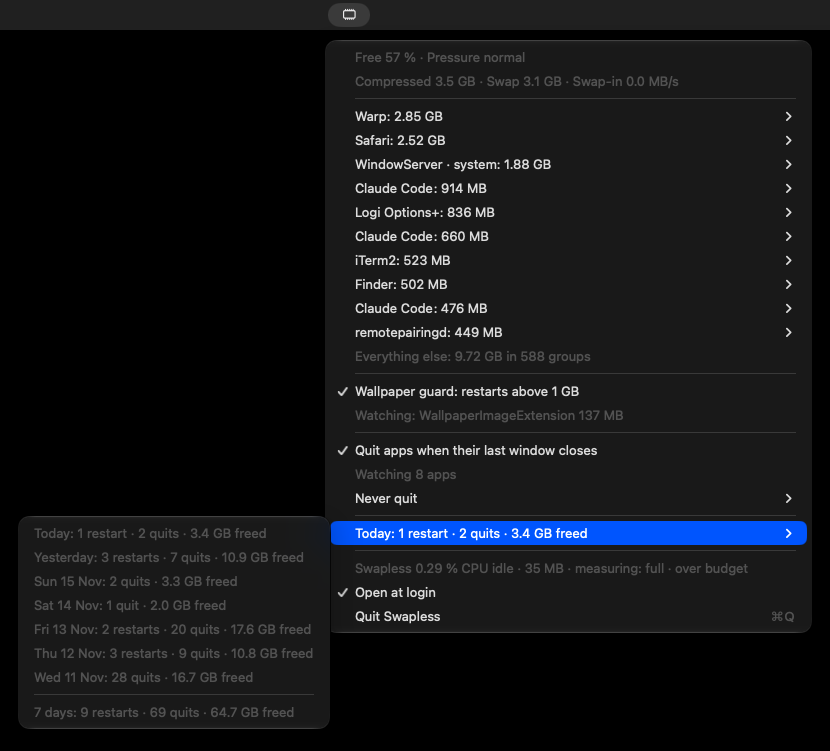
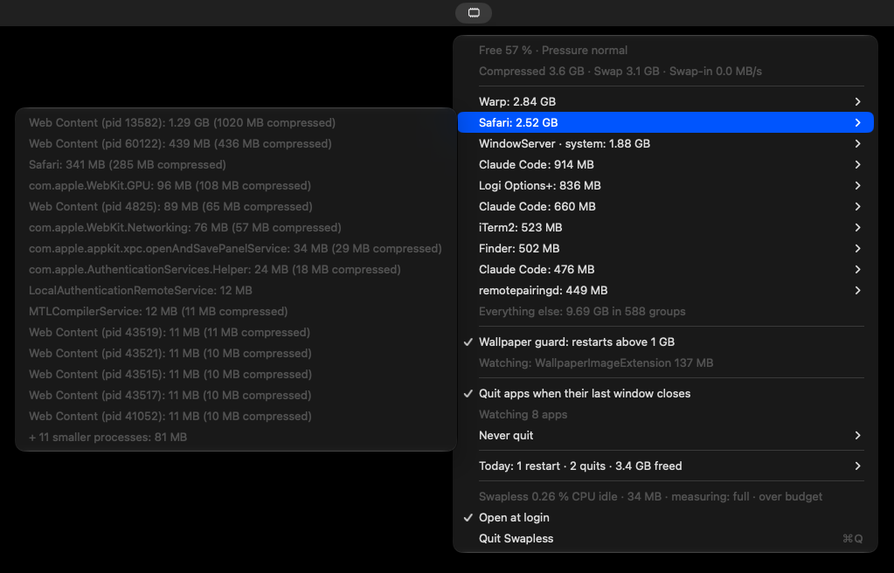
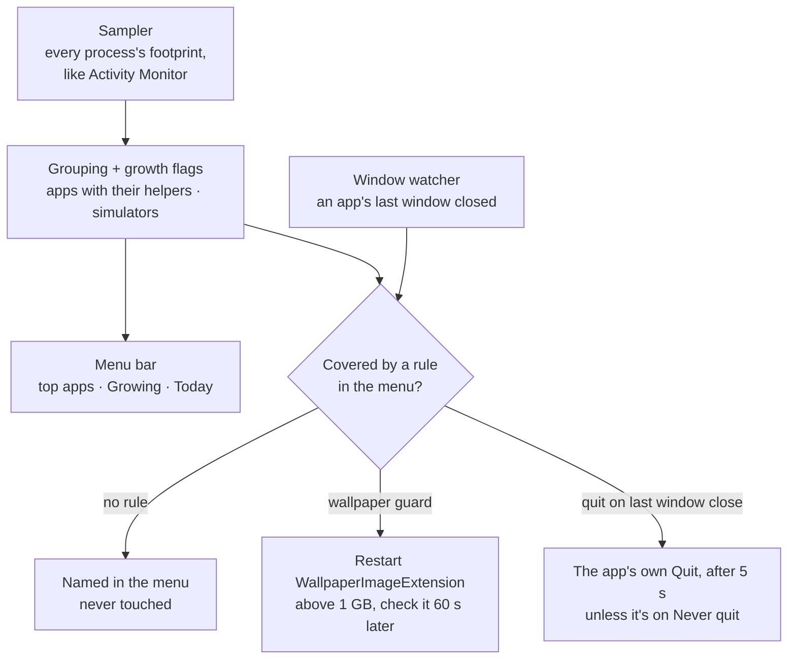

<div align="center">

# Swapless

**The menu-bar app that names what pushes a 16 GB Mac into swap — and fixes it on your rules.**

[](#install)
[](Package.swift)
[](LICENSE)
[](#roadmap)

It measures memory the way Activity Monitor does, names the **real** culprit — system processes, Safari's web-content processes and booted simulators included — and acts **only** through rules you can see and switch off in the menu.

[What it does](#what-it-does) · [Measured](#measured) · [Install](#install) · [How it works](#how-it-works) · [Roadmap](#roadmap) · [Known limits](#known-limits) · [Development](#development)



<sub>The full menu, with the Today row opened on the last 7 days.</sub>

</div>

**GB freed**, as Swapless counts it: each successful quit adds the app's memory (the app plus its helpers) read just before the quit; each wallpaper restart adds the extension's memory before minus after (60 s later), plus WindowServer's drop. Apps you reopen aren't subtracted; dry runs, refused quits and failed restarts count nothing. ([Details](DECISIONS.md#2026-11-17--before-going-public-the-tagline-the-safari-claim-and-what-freed-counts))

---

## Why

On a 16 GB Mac, swap is the slow bleed: the beach balls, the SSD wear, the "why is everything slow" after a full workday. macOS won't tell you *who* pushed it into swap — Activity Monitor shows you a wall of processes and leaves the detective work to you. Swapless does that work: it watches, it names the culprit, and it only acts through rules you can see and switch off.

## What it does

- **Measures every process the way Activity Monitor does** — real per-process footprint, not guesses.
- **Names the real culprit** — including the ones Activity Monitor leaves for you to find: system processes, Safari's web-content processes, booted iOS simulators. Each app's row opens into the processes behind it.

  

  <p align="center"><sub>Safari's row opened: each web-content process with its pid, its memory, and how much of that is compressed.</sub></p>

- **Acts only through rules you can see.** Everything else it names is displayed, never touched.
- **Known-leak guard** — restarts macOS's own wallpaper process (`WallpaperImageExtension`) when it passes 1 GB: a leak [measured at ~1 GB/h](DECISIONS.md#2026-11-05--the-wallpaper-guards-seed-maxperday-24-because-the-leak-regrows-at-1-gbh) while dynamic wallpapers play. On from the first launch; its checkmark in the menu turns it off.
- **Quit on last window close** — opt-in: an app quits about 5 s after its last window closes, unless it's on the **Never quit** list you edit from the menu. Finder is always protected.
- **Today in the menu bar** — memory pressure and swap, the top apps by footprint, a **Growing** section when a process keeps climbing, the day's restarts, quits and memory freed with 7 days of history, and a last line where Swapless reports its own CPU and memory.

## Measured

On an M1 Pro with 16 GB, by the leak rig (`scripts/leak-rig.sh`) and the owner's acceptance runs.

| What | Result | Proof |
|---|---|---|
| Swapless's own CPU, installed app, menu closed | 0.180 % of one core over 600 s (budget 0.2 %) | [rig, 2026-11-17](docs/proof/idle-cpu-under-load/rig-budget.txt) |
| Swapless's own memory, after the menu was used | 32.0 MiB (limit 40), peak 34.5 MiB | [rig, 2026-11-17](docs/proof/idle-cpu-under-load/rig-budget.txt) |
| A headless engine with quit on last window close on | 0.140 % of one core over 600 s | [rig, 2026-11-17](docs/proof/idle-cpu-under-load/rig-budget.txt) (check 5c, [spec](specs/v1-quit-on-close.md)) |
| Footprint against `top` | 56 of 56 same-user processes ≥ 50 MB within tolerance | [rig, 2026-11-17](docs/proof/idle-cpu-under-load/rig-budget.txt) |
| A synthetic leak | flagged 4.7 s after crossing 200 MB; flat and sawtooth processes: 0 flags | [rig, 2026-11-17](docs/proof/idle-cpu-under-load/rig-budget.txt) |
| No rule, no action | 0 actions in 6 runs | [rig, 2026-11-17](docs/proof/idle-cpu-under-load/rig-budget.txt) |
| The wallpaper leak | regrew 138 → 1,258 MB in 66 min; the guard's restart took it to 133 MB, and WindowServer from 1,524 to 1,139 MB | [DECISIONS.md, 2026-11-05](DECISIONS.md#2026-11-05--the-wallpaper-guards-seed-maxperday-24-because-the-leak-regrows-at-1-gbh) |
| Quit on last window close (off-screen test apps) | 13 of 13 scenarios pass; 6 quits, each 5.66–5.70 s after the last window closed | [rig, 2026-11-06](docs/proof/v1-quit-on-close/rig-quit-on-close-owner-present.txt) |

The menu's last line is Swapless measuring itself: its CPU while the menu is closed, averaged over 10 minutes, and its memory. Budget: 0.2 % of one core and 40 MB. On a quiet Mac it reads about 0.18 % ([rig, 2026-11-17](docs/proof/idle-cpu-under-load/rig-budget.txt)). It does more work while you switch apps and right after you use the menu, so in normal use, as in these screenshots, it can read a little higher and say over budget.

## Install

Requires macOS 27+ and a Swift 6.4+ toolchain.

```bash
git clone https://github.com/michael-v17/swapless.git
cd swapless
swift build && swift test
./scripts/make-cert.sh          # once per Mac (keychain prompt)
./scripts/make-app.sh release   # wrap, sign, install to /Applications, relaunch
```

Quit on last window close needs Accessibility. Until you grant it, the menu shows `Paused: needs Accessibility` and a row that opens the Accessibility pane.

## How it works



The safety rail is the design: **anything without a rule is never touched.** Today there are two rules, both in the menu: the wallpaper guard, on from the first launch, and quit on last window close, off until you turn it on. In the release build the restart can only target the wallpaper extension, and a quit is the app's own Quit.

## Roadmap

v1, built in public:

- [x] **Core** — sampler, culprits menu, growth flags, history, wallpaper guard
- [x] **Menu today** — Today row, 5 s menu refresh, idle-CPU footer
- [x] **Quit on last window close** — opt-in, with a Never-quit list
- [ ] **Quiet, actionable alerts** — an alert names the cause and offers the fix
- [ ] **Per-app rules** — watch only, restart above a threshold, quit when idle, or quit on last window close
- [ ] **Safari tab titles** — show them in Safari's submenu

## Known limits

- The menu's last line can read a little over its 0.2 % CPU budget in normal use, as in the screenshots above: it includes the work Swapless does while you switch apps and right after you use the menu ([Measured](#measured)).
- Safari's submenu lists web-content processes by pid, not tab titles: one process can host several tabs of a site.
- `Swap` in the menu is swap used since boot: it piles up over uptime and rarely shrinks. `Swap-in` is the live signal ([why](DECISIONS.md#2026-11-17--before-going-public-the-tagline-the-safari-claim-and-what-freed-counts)).

## Development

This repo is built spec-first with an AI-driven workflow — every task ships with a contract in `specs/`, decisions and their reasoning live in `DECISIONS.md`, and `main` only ever receives PRs (`WORKFLOW.md`).

```bash
swift build && swift test                                  # compile + unit tests
./scripts/leak-rig.sh [--only N | --budget | --sim | ...]  # synthetic leak rig (exit 0 = pass)
SWAPLESS_STATE_DIR=$(mktemp -d) .build/debug/Swapless --headless   # JSON-lines contract
```

- `docs/research/` — prior art and API findings
- `docs/proof/` — verification captures per shipped slice

## License

[MIT](LICENSE) © 2026 michael-v17
