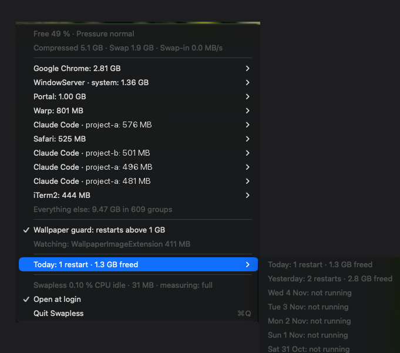
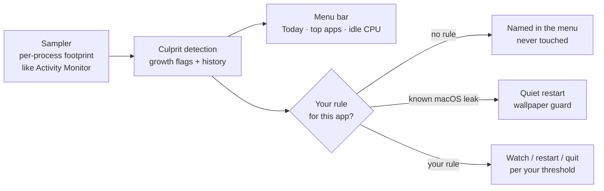

<div align="center">

# Swapless

**The menu-bar app that keeps a 16 GB Mac out of swap.**

[](#build-run-verify)
[](Package.swift)
[](LICENSE)
[](#roadmap)

It measures memory the way Activity Monitor does, names the **real** culprit — system processes, Safari tabs and booted simulators included — and fixes it **only** when you have set a rule for that app.

[What it does](#what-it-does) · [Install](#install) · [How it works](#how-it-works) · [Roadmap](#roadmap) · [Development](#development)

<!-- HERO-SCREENSHOT: clean menu-bar dropdown shot — replace the proof capture below when we take the polished one -->



</div>

---

## Why

On a 16 GB Mac, swap is the slow bleed: the beach balls, the SSD wear, the "why is everything slow" after a full workday. macOS won't tell you *who* pushed it into swap — Activity Monitor shows you a wall of processes and leaves the detective work to you. Swapless does that work: it watches, it names the culprit, and it only acts on what you've explicitly ruled on.

## What it does

- **Measures every process the way Activity Monitor does** — real per-process footprint, not guesses.
- **Names the real culprit** — including the ones other tools miss: system processes, Safari tabs, booted iOS simulators.
- **Fixes only what you have ruled on.** An app you never configured is *never* touched — it gets named, not killed.
- **Known-leak guard** — quietly restarts macOS's own leaking wallpaper process (`WallpaperImageExtension`), the classic invisible memory hole.
- **Today in the menu bar** — footprint per app, a growth map of what's expanding, and an idle-CPU footer.

## How it works



The safety rail is the design: **unknown apps are never touched.** Every automated action is either a macOS-known leak fix or a rule you wrote yourself.

## Roadmap

v1, built in public:

- [x] **Core** — sampler, culprits menu, growth flags, history, wallpaper guard
- [x] **Menu today** — Today row, 5 s menu refresh, idle-CPU footer
- [ ] **Quit on last window close** — opt-in, with per-app exceptions
- [ ] **Quiet, actionable alerts** — an alert names the cause and offers the fix
- [ ] **Per-app rules** — watch only, restart above a threshold, quit when idle, or quit on last window close

## Install

Requires macOS 27+ and a Swift toolchain.

```bash
git clone https://github.com/michael-v17/swapless.git
cd swapless
swift build && swift test
./scripts/make-cert.sh          # once per Mac (keychain prompt)
./scripts/make-app.sh release   # wrap, sign, install to /Applications, relaunch
```

## Development

This repo is built spec-first with an AI-driven workflow — every task ships with a contract in `specs/`, decisions and their reasoning live in `DECISIONS.md`, and `main` only ever receives PRs (`WORKFLOW.md`).

```bash
swift build && swift test                                  # compile + unit tests
./scripts/leak-rig.sh [--only N | --budget | --sim | ...]  # synthetic leak rig (exit 0 = pass)
SWAPLESS_STATE_DIR=$(mktemp -d) .build/debug/Swapless --headless   # JSON-lines contract
```

- `docs/research/` — prior art and API findings
- `docs/proof/` — verification captures per shipped slice

## License

[MIT](LICENSE) © 2026 michael-v17
